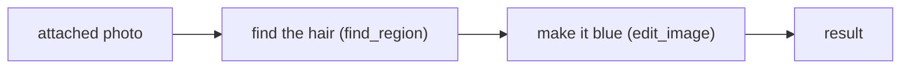

Plan: the first call's `plan`, a mermaid chart (the reply shows it):

- `flowchart LR`; a box per step in the user's words, "what it does (tool)"; the inputs and the result boxes too;
  steps that need not wait for each other as branches; 10 steps at most.
- Ids s1, s2, ... on the tools' boxes; each call gives its box's id as `step`, and the page colors the box as it runs.
  Draw the chart again only when the plan changes.
- The calls of one reply run at once. Calls whose results are joined later share a `group`: one failing stops the
  rest of it. `use_text_gpu` true lends them the chat model's GPU: only when the user wants it fast, or two heavy
  steps of different image models stand side by side.

Recipes of several tools (the one tool for a request: image-tools' list):

- Each step takes the link the step before it returned as its `image`.
- A full-body picture: generate_image, then fix_image `{"parts": ["face", "hands"]}`; upscale_image only when asked.
- A large final image with a part changed: upscale_image first, then edit_region on its result.
- A cut-out on a wider or taller canvas: remove_background, then extend_image. On a drawn background (a beach):
  edit_image alone ("on a beach").
- A part from another picture, then more: image-tools' find_region and edit_image first, the rest on their result.
- edit_region cannot take a control map: say so, rather than claiming a separate control changed its part.
- Following things in a video: segment_video.
